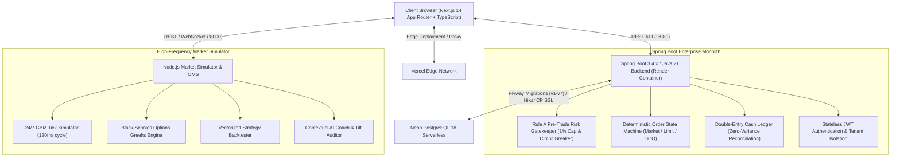

# 🚀 ApexTradeOS / TradeSphere AI

> **Institutional-Grade Stock & Options Trading Terminal**  
> *100% Free, Local-First, Zero-Dependency Architecture with 24/7 Market Simulation & Pre-Trade Risk Invariant Engine.*

---

## 🌟 Executive Summary

**ApexTradeOS (TradeSphere AI)** is a full-stack, local-first stock and options trading terminal built from the ground up to synthesize the best architectures from:
1. **ChatGPT Conversation**: Student-budget ($0 / ₹0) India-first paper-trading architecture, strict pre-trade risk controls, behavioral trade journaling, and 1% risk auto-sizing.
2. **Gemini Conversation**: 3-Tier Adaptive Progressive Complexity (Tier 1: Basic Guided, Tier 2: Active Trader, Tier 3: Pro Quant), 24/7 Geometric Brownian Motion (GBM) tick & 20-depth DOM simulator, Black-Scholes Greeks engine, and vectorized backtester.

---

## ⚡ Key Highlights & Core Invariants

### 1. 🛡️ Synchronous Pre-Trade Risk Gatekeeper
- **1% Max Single-Trade Risk Invariant**: Orders exceeding 1.0% of total account equity are rejected *before* execution with the maximum allowable position size calculated automatically.
- **Mandatory Stop-Loss Rule**: Every market or limit order strictly requires a defined stop-loss price; open-ended risk entries are blocked.
- **Minimum 1.5:1 Risk/Reward Ratio**: Recommended risk/reward enforcement for disciplined trading.
- **3.0% Daily Drawdown Circuit Breaker**: Real-time MTM monitoring that automatically halts all trading if daily losses exceed 3.0% of day-start equity.
- **Bracket OCO State Machine**: Continuous background engine that monitors ticks and triggers automated Stop-Loss or Take-Profit exits.

### 2. 🌐 24/7 Dual-Market Simulation (Zero API Keys Needed)
- **10 Core Dual-Market Instruments**:
  - **NSE (India)**: `RELIANCE`, `NIFTY50`, `TCS`, `INFY`, `HDFCBANK`, `TATAMOTORS`
  - **NASDAQ (US)**: `AAPL`, `TSLA`, `NVDA`, `MSFT`
- **Geometric Brownian Motion (GBM) Tick Feed**: Continuous drift and stochastic volatility engine broadcasting realistic market ticks every 120ms.
- **Level 2 DOM Order Book**: Real-time 20-depth Bid/Ask ladder with dynamic volume profiling.
- **Multi-Timeframe Aggregation**: 1-minute, 5-minute, 15-minute, and Daily candles enriched with real-time **EMA-20**, **VWAP**, and dynamic **Support/Resistance** levels.

### 3. 🎯 3-Tier Adaptive Progressive Complexity UI
- **Tier 1 (Basic / Guided)**: Clean simplified canvas chart, natural-language trend banner, 1% Risk Auto-Sizer, and basic position monitor for beginners.
- **Tier 2 (Active Day Trader)**: Multi-timeframe canvas charting with crosshair inspections, bracket limit/market order entry, real-time MTM PnL, and trade journaling.
- **Tier 3 (Pro Quant)**: 20-level Level 2 DOM ladder, real-time Black-Scholes Options Greeks chain (Delta, Gamma, Theta, Vega, IV), and Vectorized Strategy Backtester with visual Equity Curves.

### 4. 🧠 Contextual AI Coach & Tilt Auditor
- Evaluates technical market regime (Bullish / Bearish / Mean-Reverting Consolidation).
- Audits trader trade logs for revenge trading, tilt, premature profit-taking, and win expectancy.

### 5. 🌐 Public Website & Shared Navigation
- **Public Website Pages**:
  - **Home (`/`)**: Live continuous ticker tape, hero section, interactive 1% risk calculator widget, 3-tier progressive complexity showcase, and curriculum spotlight.
  - **Features (`/features`)**: Deep dive into synchronous risk gatekeeping, circuit breakers, 24/7 GBM simulation, 20-level DOM ladders, and Black-Scholes Greeks.
  - **Markets (`/markets`)**: Real-time simulated market quotes, sector categories, and dual-market search (NSE/BSE & US NASDAQ).
  - **Learning Academy (`/learning`)**: Curriculum modules with interactive knowledge-check quizzes.
  - **About (`/about`)**: Student-first ₹0 budget ethos, mission, and financial democratization philosophy.
  - **Contact (`/contact`)**: Validated community support and feature feedback form.
  - **Compliance & Legal (`/disclaimer`, `/privacy`, `/terms`)**: Mandatory statutory simulation disclosures and local-first data privacy policies.
  - **Authentication Flow (`/login`, `/register`)**: 1-click demo login and new account onboarding launching directly into the trading terminal.
- **Shared Navigation**: Responsive sticky navigation bar, mobile drawer, and regulatory disclaimer footer with engine status monitoring.

---

## 🏗️ System Architecture



---

## ☁️ Public Cloud Deployment Architecture

TradeSphere AI is configured for production across three cloud tiers:
1. **Frontend:** Deployed to **Vercel** with Next.js App Router, edge caching, and OWASP security headers.
2. **Backend:** Packaged into a hardened multi-stage Docker container (`eclipse-temurin:21-alpine`) running on **Render** with non-root security and G1GC memory controls.
3. **Database:** Hosted on **Neon Serverless PostgreSQL 18** with pooled connections, SSL, and automated Flyway migrations.

> See [`docs/DEPLOYMENT_GUIDE.md`](docs/DEPLOYMENT_GUIDE.md) and [`docs/PRODUCTION_READINESS_REPORT.md`](docs/PRODUCTION_READINESS_REPORT.md) for full deployment walkthroughs.

---

## 🚀 Quick Start Guide

### Prerequisites
- **Node.js**: v18+ (verified on Node.js v24.14.1)
- **Zero API keys required** — runs 100% out of the box with built-in simulation.

### One-Click Launch (Windows)
Double-click `start.bat` or run:
```bash
node start.js
```
This concurrently starts:
- **Backend API & WebSocket Server**: [http://localhost:8000](http://localhost:8000)
- **Frontend Terminal Application**: [http://127.0.0.1:3000](http://127.0.0.1:3000)

### Manual Start
```bash
# Terminal 1 - Backend
cd backend
npm start

# Terminal 2 - Frontend
cd frontend
npm run dev
```

---

## 🧪 Automated End-to-End Verification

To verify the platform programmatically:

### 1. Public Website & Shared Navigation Test Suite
```bash
node test_public_website.js
```

### 2. Core Trading Engine & Invariant Test Suite
```bash
node test_e2e.js
```

### Verification Checks:
1. `GET /api/health` — Server health & uptime.
2. `GET /api/tickers` — 10 dual-market symbols verified (NSE + NASDAQ).
3. `GET /api/candles` — Aggregated candles with rolling EMA20 & VWAP.
4. `POST /api/orders` — **1% Max Risk Gatekeeper Block Verified**.
5. `POST /api/orders` — **Mandatory Stop-Loss Guardrail Block Verified**.
6. `POST /api/orders` — **Compliant 1% Auto-Sized Order Execution Verified**.
7. `GET /api/portfolio` — Real-time Position blotter & MTM PnL Verified.
8. `POST /api/positions/close` — Manual Position Exit & R-Multiple Log Verified.
9. `GET /api/options-chain` — Black-Scholes Greeks (Delta, Gamma, Theta, IV) Verified.
10. `POST /api/backtest` — Vectorized Strategy Backtester & Equity Curve Verified.
11. `GET /api/coach` — Market Structure Regime & Tilt Detection Verified.
12. `WebSocket /ws/ticks` — Live tick streaming & Level 2 DOM Depth Verified.

---

## 📂 Project Directory Structure

```
TR AI/
├── AGENTS.md                  # Lead Architect system rules & invariants
├── README.md                  # This file
├── start.js                   # Root concurrent service launcher
├── start.bat                  # One-click Windows runner
├── test_e2e.js                # 12-point automated verification suite
├── docs/                      # Architectural specifications
│   ├── PRD.md                 # Product Requirements Document
│   ├── ARCHITECTURE.md        # Topology & technical workflows
│   ├── DATABASE.md            # Relational schema for paper trading
│   ├── API_SPEC.md            # REST & WebSocket endpoint contracts
│   ├── USER_FLOWS.md          # 3-Tier user interaction flows
│   └── ROADMAP.md             # Implementation roadmap
├── backend/                   # Node.js backend service
│   ├── package.json
│   └── src/
│       ├── server.js          # REST & WebSocket server (:8000)
│       ├── market_data/
│       │   └── simulator.js   # 24/7 GBM tick & 20-level DOM generator
│       ├── oms/
│       │   └── risk_engine.js # Pre-Trade Risk Gatekeeper & OCO monitor
│       ├── quant/
│       │   ├── options_greeks.js # Black-Scholes pricing & Greeks engine
│       │   └── backtester.js     # Vectorized multi-strategy backtester
│       └── coach/
│           └── ai_coach.js    # Behavioral tilt & market regime auditor
└── frontend/                  # React 18 + Vite + Tailwind CSS
    ├── package.json
    ├── vite.config.js
    ├── tailwind.config.js
    └── src/
        ├── App.jsx            # Multi-tier container & WS subscriber
        ├── main.jsx
        ├── index.css
        └── components/
            ├── Header.jsx           # Mode switcher, equity & breaker badge
            ├── Watchlist.jsx        # Dual-market search with tick flashes
            ├── TradingChart.jsx     # High-performance 60fps canvas chart
            ├── OrderTicket.jsx      # 1% Risk Auto-Sizer & Bracket OCO
            ├── OrderBookDOM.jsx     # 20-depth Level 2 DOM ladder
            ├── OptionsChain.jsx     # Black-Scholes Greeks table
            ├── Backtester.jsx       # Strategy tester & Canvas equity curve
            ├── PortfolioBlotter.jsx # Positions, Orders & Journal
            └── AICoachModal.jsx     # AI Coaching & Market Regime modal
```

---

## ⚖️ License
MIT License. Free for educational, research, and non-commercial trading use.
