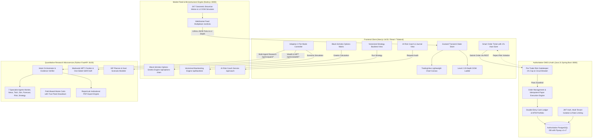

# System Architecture & Workflows — ApexTradeOS / TradeSphere AI

## 1. System Topology Overview



## 2. Real-Time Data Pipeline
1. **Tick Generator / Ingestion:**
   - When no external broker API keys are set in `.env`, the **Geometric Brownian Motion (GBM) Engine** generates high-frequency 120ms price ticks with realistic volatility, momentum drift, and random-walk fluctuations.
   - Concurrently generates 20 levels of simulated bid and ask liquidity (Level 2 DOM) with realistic spread dynamics.
   - When configured, pluggable connectors connect to Indian broker WebSockets (FYERS, Upstox, Dhan, Angel One) or US Alpaca.
2. **WebSocket Broadcast:**
   - Broadcasts normalized `TickEvent` packets over `/ws/ticks`.
   - Packet format:
     ```json
     {
       "type": "tick",
       "symbol": "RELIANCE",
       "exchange": "NSE",
       "ltp": 2984.50,
       "bid": 2984.20,
       "ask": 2984.80,
       "change": 14.50,
       "changePct": 0.49,
       "volume": 3412500,
       "dayHigh": 2998.00,
       "dayLow": 2962.10,
       "timestamp": 1793374800000,
       "bids": [[2984.20, 150], [2984.00, 320], "...20 levels"],
       "asks": [[2984.80, 210], [2985.00, 450], "...20 levels"]
     }
     ```
3. **Frontend Transient Subscriptions:**
   - Incoming ticks update the Zustand store without triggering expensive React virtual DOM diffing of unmounted components.
   - The canvas chart receives tick deltas directly, creating an ultra-smooth 60fps institutional trading experience.

## 3. Order Execution & Pre-Trade Risk Workflow
1. User clicks **"1% Risk Auto-Sizer"** on the Order Ticket.
2. The UI computes quantity based on Equity, Entry, and Stop Loss.
3. User confirms order submission.
4. The request hits the synchronous **Pre-Trade Risk Gatekeeper**:
   - Check 1: Is Stop Loss provided? (Mandatory in Basic/Active).
   - Check 2: Does $(\text{Entry} - \text{SL}) \times \text{Qty} \le \text{Equity} \times 1\%$?
   - Check 3: Is Reward-to-Risk $\ge 1.5$?
   - Check 4: Is current daily drawdown $< 3.0\%$?
   - Check 5: Is cash balance sufficient for margin requirement?
5. If **PASS**:
   - Paper engine fills order at current best Ask (Buy) or Bid (Sell) with slippage penalty.
   - Position is added to portfolio; cash ledger is debited.
   - If Bracket OCO is active, the OCO monitor registers the Stop-Loss and Take-Profit triggers.
6. If **FAIL**:
   - Synchronous HTTP 400 rejection returned immediately with human-readable error (e.g., `"Risk Breach: Trade risk (₹15,000) exceeds 1.0% limit (₹10,000). Reduce quantity or widen stop."`).

---

## 4. Spring Boot Modular Monolith Architecture

The backend service is structured as a Spring Boot 3.4.x / 4.x modular monolith on Java 21:

```text
backend-spring/
├── pom.xml                               # Java 21, Spring Boot Starters, Flyway, JJWT, SpringDoc
└── src/
    ├── main/
    │   ├── java/com/tradesphere/
    │   │   ├── TradeSphereApplication.java
    │   │   ├── common/                  # Security (JWT), Exceptions, OpenAPI Config
    │   │   └── modules/
    │   │       ├── auth/                # User credentials, BCrypt, Roles, Tier Management
    │   │       ├── instrument/          # Instruments Master & GBM Realistic Price Simulator
    │   │       ├── watchlist/           # User Watchlists & Items Isolation
    │   │       ├── screener/            # Multi-parameter Technical Pattern Screener
    │   │       ├── paper/               # Risk Gatekeeper, Paper OMS, Positions & Cash Ledger
    │   │       ├── portfolio/           # Real-time MTM Equity & Expectancy Calculation
    │   │       └── audit/               # Immutable Security & Financial Audit Logs
    │   └── resources/
    │       ├── application.yml          # Dual PostgreSQL 18 & H2 runtime config
    │       └── db/migration/            # Flyway V1 through V6 ANSI SQL Migrations
    └── test/                            # Integration test suite for Auth, Risk Gatekeeper, Portfolio & Security
```

### Key Invariants:
1. **Financial Precision:** All prices, balances, quantities, PnL, and risks are stored and computed using `java.math.BigDecimal` with explicit scale and rounding modes.
2. **Pre-Trade Risk Gatekeeper:** Order processing executes synchronously inside the `@Transactional` boundary of `PaperTradingService`, verifying the 1% single-trade risk cap, 3% daily drawdown breaker, and mandatory stop-loss.
3. **Double-Entry Cash Ledger:** Every position fill and liquidation generates immutable, debit/credit ledger records with running `balance_after` verification.
4. **User-Level Ownership:** Every financial and watchlist query is partitioned strictly by `userId`. Unaffiliated access returns `404 Not Found`.

---

## 5. Market Research & TradingView Lightweight Charts Engine

### 5.1 Pluggable Market Data Provider
- Standard `MarketDataProvider` interface decouples market data consumption from transport.
- Default `SyntheticMarketDataProvider` generates realistic 24/7 Geometric Brownian Motion (GBM) ticks and OHLCV bars.
- Mandatory metadata tags (`source`, `dataType: 'SIMULATED'`, `isSimulated: true`, `dataFreshness`, `timestamp`) accompany all quotes, candles, and market overviews to guarantee that simulated data is never confused with live exchange data.

### 5.2 Mathematical Indicators Engine
Zero-drift calculations for 8 institutional indicators:
1. **SMA:** Configurable moving averages (20, 50, 200).
2. **EMA:** Multiplier $k = \frac{2}{n+1}$, seeded with initial SMA.
3. **RSI:** J. Welles Wilder's modified exponential smoothing over 14 periods.
4. **MACD:** Fast 12 EMA, Slow 26 EMA, MACD line, 9-EMA Signal line, and Histogram.
5. **Bollinger Bands:** 20-period SMA middle band with $\pm 2\sigma$ volatility envelopes and %b oscillator.
6. **ATR:** Wilder's 14-period True Range smoothing across overnight gaps.
7. **VWAP:** Volume-weighted typical price accumulation.
8. **Supertrend:** Period 10 ATR with 3.0 multiplier and ratchet reversal conditions.

### 5.3 TradingView Lightweight Charts Integration
- Implements `lightweight-charts` v5.2 in Next.js.
- Responsive layout via `ResizeObserver`.
- Dynamic crosshair legend with OHLCV statistics.
- Interactive indicator toggle buttons.
- Complies with TradingView Lightweight Charts attribution guidelines.
