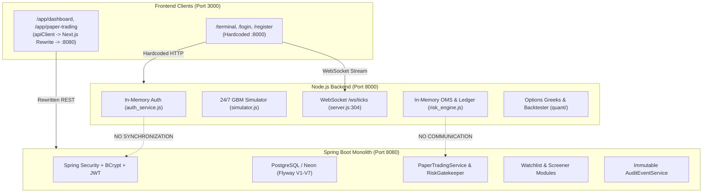

# BACKEND CONFLICTS & OWNERSHIP AUDIT — APEXTRADEOS / TRADESPHERE AI

**Date:** October 31, 2026  
**Auditor:** Principal Software Architect  
**Scope:** Architectural collision analysis between Node.js (`backend/`, :8000) and Spring Boot (`backend-spring/`, :8080).

---

## 1. The Dual-Backend Architecture Problem

TradeSphere AI contains two fully functioning, independent backend services within the same repository. Neither backend acts as a gateway or downstream proxy for the other; rather, both claim primary ownership over core FinTech workflows.



This split creates severe system hazards:
1. **State Desynchronization:** An order placed in `/terminal` updates the in-memory JavaScript Map in Node.js, leaving the PostgreSQL database in Spring Boot completely unaware. Conversely, an order placed via `/app/paper-trading` persists to PostgreSQL, but never appears on the `/terminal` portfolio blotter.
2. **Account Capital Discrepancy:** A user resetting capital on `/terminal` resets Node's in-memory `1,000,000.00` balance. The PostgreSQL `paper_accounts` record remains unchanged.
3. **Ghost Users:** Registering on `/register` saves the user into Node's in-memory array. The user cannot log in to any Spring Boot endpoint because their credentials were never inserted into the `users` table in PostgreSQL.

---

## 2. Comprehensive Endpoint Collision Matrix

| Endpoint Path | Node.js Handler (`backend/src/server.js`) | Spring Boot Controller (`backend-spring/...`) | Behavioral Conflict & Schema Incompatibility |
| :--- | :--- | :--- | :--- |
| `GET /api/health` | Line 48: Returns `{ status: 'healthy', simulator: 'active' }` | `HealthCheckController.java:22`: Returns `{ status: 'UP', database: 'CONNECTED' }` | Node returns 200 with process uptime; Spring returns DB connection status and migration baseline. |
| `POST /api/auth/register` | Line 55: Calls `authService.register` (In-memory Map) | `AuthController.java:31`: Calls `authService.registerUser` (DB + BCrypt) | Node returns `{ token, user: { id, email, tier } }`. Spring returns `{ token, user: UserProfileResponse }` with persisted foreign keys. |
| `POST /api/auth/login` | Line 74: Validates against in-memory user Map | `AuthController.java:38`: Validates via `AuthenticationManager` against PostgreSQL | Passwords registered on Node fail on Spring; tokens issued by Node fail JJWT validation in Spring due to different secret keys. |
| `GET /api/tickers` | Line 108: Returns `simulator.getAllTickers()` (10 items, including `NIFTY50`) | `MarketDataController.java:36`: Returns DB-backed quotes (12 items, no `NIFTY50`, includes `AMZN`) | Divergent symbol catalogues and divergent real-time price states. |
| `GET /api/instruments` | Line 108: Returns `{ instruments, tickers }` | `InstrumentController.java:31`: Returns `List<InstrumentDto>` from PostgreSQL | Node returns static JS objects; Spring returns JPA entities with sector, industry, tickSize, and lotSize. |
| `GET /api/candles` | Line 120: Dynamic rolling candles from `simulator.getCandles()` | `MarketDataController.java:49`: Synthetic generator from `marketDataService.getCandles()` | Different OHLC values for identical timestamp intervals. |
| `GET /api/portfolio` | Line 130: Returns `oms.getPortfolio()` (Single global in-memory account) | `PortfolioController.java:27`: Returns `PortfolioSummaryResponse` (Scoped to `userId`) | Node has no tenant isolation; Spring calculates Net Liquidation mark-to-market from database positions. |
| `POST /api/portfolio/reset` | Line 137: Calls `oms.resetAccount()` (Resets in-memory state) | `PaperAccountController.java:40`: `POST /api/accounts/reset` (Resets DB rows) | Different URL paths (`/api/portfolio/reset` vs `/api/accounts/reset`) and unlinked data stores. |
| `POST /api/orders` | Line 164: Calls `oms.submitOrder()` (In-memory, unauthenticated) | `OrderController.java:28`: Calls `paperTradingService.placeOrder()` (Requires JWT, DB-backed) | Node accepts string IDs (`ord_xyz`); Spring accepts numeric primary keys (`Long id`) and enforces `UserPrincipal`. |
| `DELETE /api/orders/{id}` | Line 184: Calls `oms.cancelOrder(orderId)` (String ID) | `OrderController.java:43`: Calls `paperTradingService.cancelOrder(Long id)` | Incompatible ID types (UUID string in Node vs Long integer in Spring Boot). |
| `POST /api/accounts/configure` | Line 198: Sets in-memory capital, slippage, and fee rates | `PaperAccountController.java:32`: Updates `paper_accounts` row in PostgreSQL | Node updates runtime object; Spring performs transactional DB update with audit event. |
| `GET /api/accounts/reconcile` | Line 213: Reconciles in-memory `cashLedger` array | `PaperAccountController.java:49`: Reconciles `cash_ledger_entries` table | Different reconciliation results if orders were placed on both backends. |
| `GET /api/ledger` | Line 220: Returns `oms.getCashLedger()` (Last 100 entries from memory) | `LedgerController.java:23`: Returns `cashLedgerEntryRepository.findByAccountId` | Node ledger lacks relational links to order/trade IDs. |

---

## 3. Unique, Non-Overlapping Capabilities

### 3.1 Node.js Capabilities Missing in Spring Boot
The following endpoints exist **only in Node.js** (`backend/src/server.js`):
1. **WebSocket Real-Time Tick Streaming (`/ws/ticks`):** Lines 304–318. Delivers 120ms tick updates, price flashes, snapshots, and circuit-breaker alerts. Spring Boot has no WebSocket server configured.
2. **20-Level Depth of Market Ladder (DOM):** Generated on every tick in [backend/src/market_data/simulator.js](file:///c:/Users/hello/Desktop/antigravity%20products/TR%20AI/backend/src/market_data/simulator.js#L140-L185). Essential for Tier 3 Pro Quant view.
3. **Black-Scholes Options Greeks Engine (`GET /api/options-chain`):** Lines 243–252. Dynamically calculates $\Delta, \Gamma, \Theta, \nu$ across 11 strike prices centered on spot.
4. **Vectorized Strategy Backtester (`POST /api/backtest`):** Lines 254–279. Runs EMA Cross, RSI Mean Reversion, and VWAP Breakout backtests over candle data.
5. **Contextual AI Risk Coach (`GET /api/coach`):** Lines 281–296. Deterministic rules evaluating 20-EMA, VWAP, RSI, and trade journal behavioral discipline.

### 3.2 Spring Boot Capabilities Missing in Node.js
The following endpoints exist **only in Spring Boot** (`backend-spring/`):
1. **Multi-Market Watchlists (`/api/watchlists`):** `WatchlistController.java:22`. Full CRUD for user watchlists with items linked to master instruments.
2. **Stock Screener (`/api/screener`):** `ScreenerController.java:20`. Multi-criteria filtering by market, sector, P/E ratio, RSI, and technical setup.
3. **Immutable Audit Events (`/api/audit`):** `AuditController.java:21`. Full audit log recording user actions, risk breaches, and order status transitions.
4. **User Profile Settings (`/api/users/profile`):** `UserController.java:20`. Allows changing starting capital, risk caps, and trading tier preferences.
5. **Role-Based Security & Tenant Isolation:** Enforced via `JwtAuthenticationFilter.java` and Spring Data JPA specifications.

---

## 4. Orchestration & Deployment Discrepancy

A major operational conflict exists between local runtime orchestration and cloud deployment configuration:

### 4.1 Local Development Launcher: `start.js`
In [start.js](file:///c:/Users/hello/Desktop/antigravity%20products/TR%20AI/start.js#L22-L35):
```javascript
// 1. Start Backend Server
const backend = spawn('node', ['src/server.js'], {
  cwd: backendDir, // backend/
  stdio: 'inherit',
  shell: true
});

// 2. Start Frontend Next.js Server
const frontend = spawn('npx', ['next', 'start', '-p', '3000'], {
  cwd: frontendDir, // frontend/
  stdio: 'inherit',
  shell: true
});
```
- **Finding:** `start.js` spawns **only Node.js (:8000)** and **Next.js (:3000)**. Spring Boot is completely omitted.
- **Consequence:** When running locally via `npm start` or `node start.js`, any frontend component attempting to access `/api/watchlists`, `/api/screener`, or `/api/users/profile` on Spring Boot fails or falls back to synthetic fixtures.

### 4.2 Cloud Deployment Blueprint: `render.yaml`
In [render.yaml](file:///c:/Users/hello/Desktop/antigravity%20products/TR%20AI/render.yaml#L5-L19):
```yaml
services:
  - type: web
    name: tradesphere-backend
    runtime: docker
    rootDir: backend-spring
    dockerfilePath: Dockerfile
    dockerContext: .
    plan: free
    region: oregon
    healthCheckPath: /api/health
    envVars:
      - key: SPRING_PROFILES_ACTIVE
        value: prod
      - key: PORT
        value: 8080
```
- **Finding:** `render.yaml` deploys **only Spring Boot (:8080)** into the Render cloud environment. Node.js is completely omitted.
- **Consequence:** In cloud production, the Node.js backend does not exist. Any frontend request calling `http://localhost:8000`, `/ws/ticks`, `/api/options-chain`, `/api/backtest`, or `/api/coach` immediately fails with `ECONNREFUSED`.

---

## 5. Architectural Verdict & Target Resolution

The dual-backend architecture is unsustainable in production. The system must be unified under a single cohesive topology:
- **Primary Service Gateway:** Spring Boot (`backend-spring/`) must remain the single source of truth for Authentication, User Identity, Database Persistence, OMS, Pre-Trade Risk Gatekeeping, Double-Entry Ledger, Watchlists, and Audit Logging.
- **Quant & Market Data Engine:** The high-frequency capabilities of Node.js (24/7 GBM streaming, 20-depth DOM, Black-Scholes Greeks, Backtesting, AI Coach) must either be:
  - *Option A:* Ported natively into Java 21 Spring Boot modules (consolidated monolith).
  - *Option B:* Retained as a dedicated, stateless Quant Microservice routed and authenticated via Spring Boot or an API gateway.
