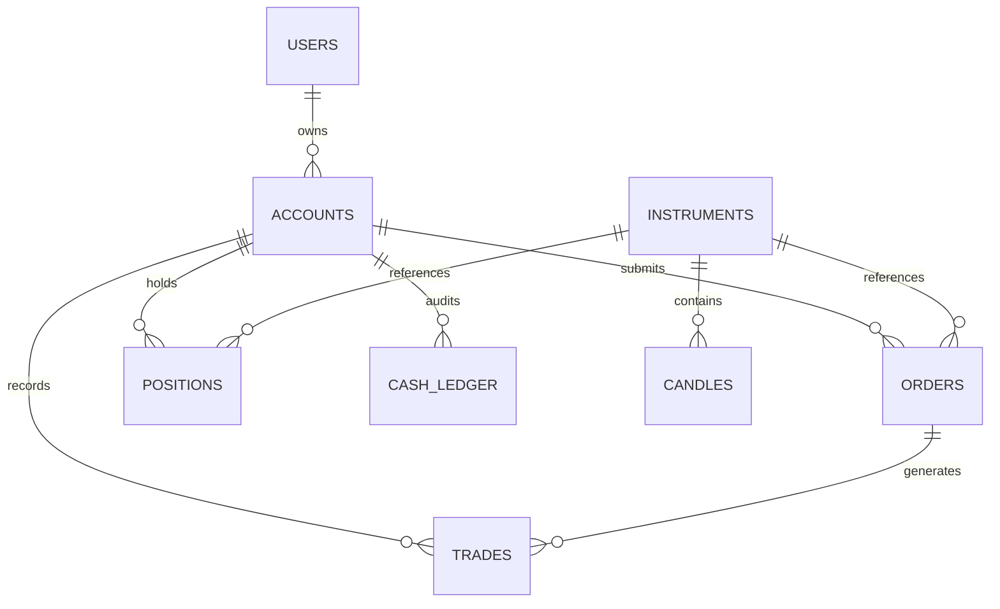

# Database & Entity Design — ApexTradeOS / TradeSphere AI

## 1. Relational Schema Overview (SQLite / PostgreSQL)

## 2. Table Specifications

### 2.1 `accounts`
Stores paper trading capital, starting balance, and daily high-water marks for circuit breaker tracking.
| Column | Type | Constraints | Description |
|---|---|---|---|
| `id` | TEXT / UUID | PRIMARY KEY | Unique account identifier |
| `name` | TEXT | NOT NULL | Display name (e.g., "Paper Trading Pro") |
| `currency` | TEXT | NOT NULL | `INR` or `USD` |
| `initial_equity` | REAL | NOT NULL | Starting cash (e.g., 1000000.0) |
| `current_cash` | REAL | NOT NULL | Available unencumbered cash balance |
| `day_start_equity` | REAL | NOT NULL | Equity recorded at 09:15 AM IST / 09:30 AM EST |
| `daily_loss_limit_pct` | REAL | DEFAULT 3.0 | Circuit breaker threshold (3%) |
| `max_risk_per_trade_pct`| REAL | DEFAULT 1.0 | Single trade loss cap (1%) |
| `trading_locked` | BOOLEAN | DEFAULT FALSE | Locked if circuit breaker triggered |

### 2.2 `instruments`
Master dictionary of tradeable equities, indices, and derivatives.
| Column | Type | Constraints | Description |
|---|---|---|---|
| `symbol` | TEXT | PRIMARY KEY | Symbol ticker (e.g. `RELIANCE`, `AAPL`) |
| `name` | TEXT | NOT NULL | Full company name |
| `exchange` | TEXT | NOT NULL | `NSE`, `BSE`, `NASDAQ`, `NYSE` |
| `segment` | TEXT | NOT NULL | `EQUITY`, `INDEX`, `OPTIONS` |
| `lot_size` | INTEGER | DEFAULT 1 | Lot size for derivatives / equities |
| `tick_size` | REAL | DEFAULT 0.05 | Minimum price movement increment |

### 2.3 `orders`
Audit trail of every submitted order, bracket leg, and fill event.
| Column | Type | Constraints | Description |
|---|---|---|---|
| `id` | TEXT / UUID | PRIMARY KEY | Order ID |
| `account_id` | TEXT | FOREIGN KEY | Associated account |
| `symbol` | TEXT | NOT NULL | Instrument symbol |
| `side` | TEXT | NOT NULL | `BUY` or `SELL` |
| `order_type` | TEXT | NOT NULL | `MARKET`, `LIMIT`, `BRACKET` |
| `quantity` | INTEGER | NOT NULL | Number of shares / contracts |
| `limit_price` | REAL | NULLABLE | Execution ceiling/floor |
| `stop_loss` | REAL | NULLABLE | Mandatory in Basic/Active |
| `take_profit` | REAL | NULLABLE | Target exit price |
| `status` | TEXT | NOT NULL | `PENDING`, `FILLED`, `CANCELLED`, `REJECTED` |
| `risk_amount` | REAL | NOT NULL | Computed total capital at risk |
| `risk_ratio` | REAL | NULLABLE | Computed Reward:Risk ratio |
| `created_at` | INTEGER | NOT NULL | Epoch timestamp in milliseconds |

### 2.4 `positions`
Real-time open positions with live mark-to-market calculations.
| Column | Type | Constraints | Description |
|---|---|---|---|
| `symbol` | TEXT | PRIMARY KEY | Active instrument |
| `side` | TEXT | NOT NULL | `LONG` or `SHORT` |
| `quantity` | INTEGER | NOT NULL | Net open position size |
| `average_price` | REAL | NOT NULL | Weighted average entry price |
| `current_price` | REAL | NOT NULL | Updated live by WebSocket feed |
| `unrealized_pnl` | REAL | NOT NULL | $(P_{current} - P_{avg}) \times Qty$ |
| `stop_loss` | REAL | NULLABLE | Active stop price |
| `take_profit` | REAL | NULLABLE | Active target price |

### 2.5 `trades` (Trade Journal)
Historical filled orders with post-trade analytics and psychological tagging.
| Column | Type | Constraints | Description |
|---|---|---|---|
| `id` | TEXT / UUID | PRIMARY KEY | Execution ID |
| `order_id` | TEXT | NOT NULL | Originating order |
| `symbol` | TEXT | NOT NULL | Instrument |
| `side` | TEXT | NOT NULL | `BUY` or `SELL` |
| `quantity` | INTEGER | NOT NULL | Filled quantity |
| `execution_price` | REAL | NOT NULL | Exact fill price |
| `realized_pnl` | REAL | DEFAULT 0.0 | Closed PnL |
| `r_multiple` | REAL | NULLABLE | Realized $R$ performance |
| `setup_tag` | TEXT | NULLABLE | e.g. "EMA Crossover", "Breakout" |
| `timestamp` | INTEGER | NOT NULL | Fill timestamp |

---

## 3. Flyway Database Migrations (PostgreSQL 18 & H2)

The Spring Boot modular monolith uses Flyway for schema management:

| Migration File | Description | Tables Created / Seeded |
|---|---|---|
| `V1__create_users_and_roles.sql` | User identities, tiers, BCrypt auth, and roles | `users`, `roles`, `user_roles` |
| `V2__create_instruments_and_market_data.sql` | Master instruments catalogue across NSE, BSE, NASDAQ, NYSE | `instruments` |
| `V3__create_watchlists.sql` | User watchlists and instrument items | `watchlists`, `watchlist_items` |
| `V4__create_paper_accounts_and_ledger.sql` | Paper accounts and double-entry cash ledger | `paper_accounts`, `cash_ledger_entries` |
| `V5__create_orders_trades_positions.sql` | Paper orders, trades blotter, and open positions | `paper_orders`, `paper_trades`, `positions` |
| `V6__create_audit_events.sql` | Immutable audit trail for security and financial actions | `audit_events` |
