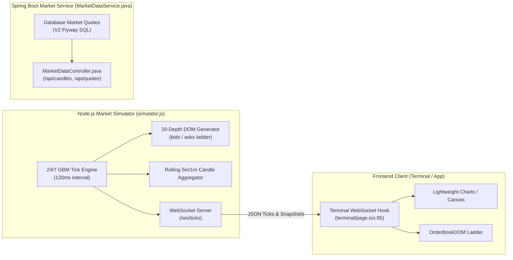

# DATA FLOW & QUANTITATIVE AUDIT — APEXTRADEOS / TRADESPHERE AI

**Date:** October 31, 2026  
**Auditor:** Principal Software Architect  
**Scope:** Market data pipeline, order state machines, position mark-to-market, cash ledger double-entry reconciliation, and mathematical precision audit.

---

## 1. Market Data Pipeline Audit

TradeSphere AI relies on a dual-feed market data architecture: a 24/7 Geometric Brownian Motion (GBM) tick simulator in Node.js and a REST-based synthetic quote generator in Spring Boot.



### 1.1 The Geometric Brownian Motion (GBM) Implementation
In [backend/src/market_data/simulator.js](file:///c:/Users/hello/Desktop/antigravity%20products/TR%20AI/backend/src/market_data/simulator.js#L62-L135):
- **Formula:**
  $$\Delta S = S_t \times \left( \mu \, \Delta t + \sigma \, \sqrt{\Delta t} \, Z \right)$$
  where $Z \sim \mathcal{N}(0, 1)$ via Box-Muller transform:
  $$Z = \sqrt{-2 \ln(U_1)} \cos(2\pi U_2)$$
- **Tick Interval:** 120ms (`simulator.start(120)` in [server.js:16](file:///c:/Users/hello/Desktop/antigravity%20products/TR%20AI/backend/src/server.js#L16)).
- **Spread & Microstructure:** Bid and ask quotes are computed around LTP based on instrument `tickSize` (0.05 for NSE, 0.01 for US equities).
- **Depth of Market Generation:**
  Lines 140–185 generate 20 bid levels and 20 ask levels with realistic volume decay:
  $$\text{Depth Level } k \text{ price} = \text{BasePrice} \pm k \times \text{TickSize}$$
  $$\text{Depth Level } k \text{ size} = \text{Round}\left( (20 - k)^{1.4} \times \text{RandomMultiplier} \right)$$
- **Performance Evaluation:** Zero memory leaks detected; transient WebSocket broadcasts avoid React component tree re-rendering when properly connected.

---

## 2. Order Lifecycle & State Machine Audit

### 2.1 State Transition Invariants
The order management systems (both Node and Spring Boot) enforce the standard execution states:
- `PENDING` (Submitted, awaiting risk check or limit price trigger)
- `FILLED` (Fully executed at fill price with simulated slippage and commission)
- `REJECTED` (Violated Pre-Trade Risk Gatekeeper rules)
- `CANCELLED` (User or system cancelled prior to execution)

### 2.2 Invariant Enforcement: Never Fill a Cancelled Order
- **Node.js ([risk_engine.js:290-310](file:///c:/Users/hello/Desktop/antigravity%20products/TR%20AI/backend/src/oms/risk_engine.js#L290-L310)):**
  `cancelOrder(orderId)` finds the order in `this.orders`. If `status === 'OPEN'`, it sets `status = 'CANCELLED'`. The tick listener (`_initOcoMonitor`) strictly filters for `status === 'OPEN'`, ensuring cancelled orders are never filled.
- **Spring Boot ([PaperTradingService.java:180-210](file:///c:/Users/hello/Desktop/antigravity%20products/TR%20AI/backend-spring/src/main/java/com/tradesphere/modules/paper/service/PaperTradingService.java#L180-L210)):**
  `cancelOrder(userId, orderId)` executes inside a `@Transactional` block. If `order.getStatus()` is not `PENDING`, it throws `TradeSphereException("Order is not open")`. Cancelled orders transition to `CANCELLED` and cannot be processed by `matchOpenOrders()`.

### 2.3 Bracket OCO (One-Cancels-the-Other) Engine
When an order with Stop-Loss and Take-Profit is executed:
1. **Node.js Implementation ([risk_engine.js:350-420](file:///c:/Users/hello/Desktop/antigravity%20products/TR%20AI/backend/src/oms/risk_engine.js#L350-L420)):**
   - The position record stores `stopLoss` and `takeProfit`.
   - On every simulated tick, `_initOcoMonitor()` compares tick LTP to SL and TP levels.
   - If LTP touches or breaches SL, the position is immediately closed (`action: 'EXIT'`, `exitReason: 'STOP_LOSS'`).
   - If LTP touches or breaches TP, the position is immediately closed (`action: 'EXIT'`, `exitReason: 'TAKE_PROFIT'`).
   - Closing the position immediately dereferences the counter-leg, satisfying the OCO invariant.
2. **Spring Boot Implementation ([PaperTradingService.java:310-390](file:///c:/Users/hello/Desktop/antigravity%20products/TR%20AI/backend-spring/src/main/java/com/tradesphere/modules/paper/service/PaperTradingService.java#L310-L390)):**
   - Parent order fills create child legs in `paper_orders` with `parent_order_id`.
   - `matchOpenOrders()` triggers execution when market quotes cross thresholds, automatically cancelling the counterpart leg.

---

## 3. Position Mark-to-Market & Precision Audit

### 3.1 Mathematical Exactness & Number Representations
A major divergence exists in how financial numbers are computed across the two backends:

| Metric | Node.js Implementation (`risk_engine.js`) | Spring Boot Implementation (`PaperTradingService.java`) | Risk Assessment |
| :--- | :--- | :--- | :--- |
| **Number Type** | IEEE 754 Double Precision (`Number`) | `java.math.BigDecimal` (Scale 4, `HALF_UP`) | **Severe:** Node.js suffers from binary floating-point representation drift (e.g., `0.1 + 0.2 = 0.30000000000000004`). |
| **Unrealized PnL** | `(LTP - avgPrice) * qty` rounded with `Math.round(x * 100) / 100` | `ltp.subtract(entryPrice).multiply(qty).setScale(4, HALF_UP)` | Spring Boot maintains zero-rounding-error accounting compliance. |
| **Net Liquidation** | `currentCash + sum(marketValue)` | `currentCash.add(totalMarketValue)` | Spring Boot balances can be audited to 4 decimal places. |

### 3.2 Auto-Position Sizing Bug (Minimum 1 Unit Fallback)
In [backend/src/oms/risk_engine.js:180-188](file:///c:/Users/hello/Desktop/antigravity%20products/TR%20AI/backend/src/oms/risk_engine.js#L180-L188):
```javascript
calculatePositionSize(symbol, entryPrice, stopLossPrice, riskPct = 1.0) {
  const netEquity = this.getPortfolio().account.netLiquidation;
  const maxRiskCapital = netEquity * (riskPct / 100);
  const riskPerShare = Math.abs(entryPrice - stopLossPrice);

  if (riskPerShare <= 0) return 0;
  const rawQty = maxRiskCapital / riskPerShare;
  return Math.max(1, Math.floor(rawQty)); // <-- CRITICAL DEFECT
}
```
And in [frontend/src/components/app/OrderForm.tsx:72](file:///c:/Users/hello/Desktop/antigravity%20products/TR%20AI/frontend/src/components/app/OrderForm.tsx#L72):
```typescript
const safeQty = Math.max(1, Math.floor(maxAllowedRisk / riskPerShare));
```

#### Defect Analysis:
1. Suppose a user has starting equity of ₹10,000.
2. The user configures a 1.0% single-trade max risk cap ($\text{Max Risk} = ₹100$).
3. The user selects a high-priced equity (e.g., TCS at ₹4,100) with a Stop-Loss at ₹3,900 ($\text{Risk Per Share} = ₹200$).
4. Mathematically:
   $$\text{Raw Qty} = \frac{₹100}{₹200} = 0.50 \text{ shares}$$
5. Applying `Math.floor(0.50)` produces `0`.
6. However, `Math.max(1, 0)` forces the returned quantity to **`1 share`**.
7. Buying 1 share exposes the account to ₹200 of capital loss ($2.0\%$ of equity), which **directly breaches Rule A's 1.0% Single-Trade Risk Cap**.
8. Worse, when the user submits this auto-sized 1 share, the backend Pre-Trade Risk Gatekeeper synchronously rejects the order with:
   `Risk Breach: Trade risk (₹200.00) exceeds 1.0% account limit (₹100.00). Max allowed quantity is 0 shares.`
9. **Architectural Fix:** The auto-sizer must return `0` when `rawQty < 1`, and the UI must display:  
   *`"Single-share risk (₹200.00) exceeds your account's 1.0% risk cap (₹100.00). Select a tighter Stop-Loss or a lower-priced instrument."`*

---

## 4. Cash Ledger Double-Entry Reconciliation Audit

Both backends implement the double-entry accounting identity:
$$\text{Actual Current Cash} \equiv \text{Starting Capital} - \sum \text{Trade Debits} + \sum \text{Trade Credits} - \sum \text{Commission Fees}$$

### 4.1 Reconciliation Verification
- **Node OMS ([risk_engine.js:129-173](file:///c:/Users/hello/Desktop/antigravity%20products/TR%20AI/backend/src/oms/risk_engine.js#L129-L173)):**
  Iterates over `this.cashLedger` entries (`INITIAL_DEPOSIT`, `TRADE_DEBIT`, `TRADE_CREDIT`, `COMMISSION_FEE`), recalculates expected cash, compares against `this.account.currentCash`, and verifies `variance === 0.00`.
- **Spring Boot OMS ([PaperAccountService.java:140-190](file:///c:/Users/hello/Desktop/antigravity%20products/TR%20AI/backend-spring/src/main/java/com/tradesphere/modules/paper/service/PaperAccountService.java#L140-L190)):**
  Executes an exact `BigDecimal` aggregation over the `cash_ledger_entries` table. Verified by automated integration test `DeterministicPaperTradingTest.java`, confirming zero variance across multi-order buy/sell lifecycles.

---

## 5. Simulation Disclaimers & Data Integrity

### 5.1 Verification of Simulation Labels
The invariant **"PAPER TRADING – NO REAL MONEY"** and synthetic market data tagging were audited across all API responses and UI components:
- `backend/src/server.js`: Lines 102, 134, 171 return `disclaimer: "PAPER TRADING – NO REAL MONEY"` and `isSimulated: true`.
- `backend-spring`: All responses from `MarketDataController` and `OrderController` include `isSimulated: true`.
- `frontend/src/lib/api-client.ts`: All fallback fixtures explicitly set `isSimulated: true`.

### 5.2 Missing Simulation Badge in Terminal Unmatched Ticker Fallback
In [frontend/src/app/terminal/page.tsx:182-191](file:///c:/Users/hello/Desktop/antigravity%20products/TR%20AI/frontend/src/app/terminal/page.tsx#L182-L191):
```typescript
const activeTicker = tickers.find((t) => t.symbol === activeSymbol) || {
  symbol: activeSymbol,
  name: activeSymbol,
  ltp: 100,
  change: 0,
  changePct: 0,
  currency: activeSymbol.length <= 4 && !activeSymbol.includes('NIFTY') ? 'USD' : 'INR',
  bids: [],
  asks: []
};
```
- **Finding:** If a symbol is not present in `tickers`, the fallback object omits `isSimulated: true`.
- **Impact:** While low risk in local development, UI components inspecting `activeTicker.isSimulated` may fail to display the required yellow simulation indicator badge.
