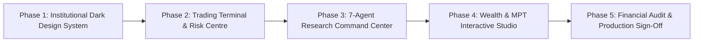

# Implementation Roadmap — TradeSphere AI
## Non-Destructive Phased Execution Sequence

**Document Version:** 1.0.0  
**Date:** October 31, 2026  
**Author:** Principal FinTech Software Architect & Engineering Lead  
**Status:** Awaiting User Approval to Begin Source-Code Implementation

---

## 1. Phased Execution Principles

To guarantee that zero existing features are broken or regressed during the product transformation, all development follows strict non-destructive principles:
1. **No Application Source-Code Modification Without Prior Approval:** Architectural blueprints, schemas, and design systems are established first.
2. **Atomic Microservice Ownership:** Each tier retains clear boundaries. Spring Boot owns state and ledger, Node streams market feeds, Python calculates quant models.
3. **Continuous Test Gatekeeping:** Before and after each phase, all 78 automated tests must exit with code 0.
4. **Preservation of Verified Logic:** The working 1% Risk Auto-Sizer (0-unit fallback), Black-Scholes Greeks, and Double-Entry Cash Ledger are preserved and built upon.

---

## 2. Phased Implementation Sequence

### Phase 1: Institutional Dark Theme & Global Navigation
- **Objective:** Upgrade the Next.js visual presentation across all 50 routes to the institutional dark palette.
- **Key Tasks:**
  1. Configure `tailwind.config.js` with exact semantic color tokens (`#090D12` canvas, `#0D131A` sidebar, `#111922` panel, `#151F29` elevated, `#25313D` border, `#35C69A` bullish, `#EF6468` bearish, `#D8AB5E` warning).
  2. Implement unified dark sidebar navigation linking all 33 features cleanly across 5 sections (Overview, Trading, Research, Quant Intelligence, Wealth Management, Risk, Learning).
  3. Apply tabular monospace typography (`IBM Plex Mono` / `Geist Mono`) to all financial tables, prices, quantities, and PnL badges.
- **Verification Gate:** `npm run build` succeeds with 0 errors; all routes render with deep `#090D12` background without light-theme flashes.

### Phase 2: Professional Trading Terminal & Risk Centre Enhancements
- **Objective:** Elevate the primary trading desk (`/terminal`) and risk management tools to institutional standards.
- **Key Tasks:**
  1. Update TradingView Lightweight Charts canvas to institutional dark styling with crosshair inspection and timeframe selectors (1m, 5m, 15m, 1D).
  2. Connect Level 2 20-depth DOM ladder with visual depth bars and one-click rung order placement.
  3. Integrate the full 11-strike Options Chain with Greeks ($\Delta, \Gamma, \Theta, \nu$) and Newton-Raphson IV skew chart.
  4. Implement persistent Trade Journal notes and setup tags in Spring Boot (`Flyway V8` migration).
  5. Add AI Tilt Auditor behavioral alert banner (detecting revenge trading or moving stop-loss wider).
- **Verification Gate:** `npm test` in `frontend/`, `mvn test` in `backend-spring/`, `npm test` in `backend/` all pass.

### Phase 3: Seven-Agent Research Command Center & Intelligence
- **Objective:** Provide a command center interface for multi-agent quantitative investment research.
- **Key Tasks:**
  1. Build an interactive agent workflow visualizer on `/app/quant/multi-agent` showing real-time agent activation pipeline (Intent Router $\to$ Active Specialist Agents $\to$ Evidence Verifier).
  2. Implement direct "Export Institutional PDF" download triggers for research runs via `/api/v1/quant/reports/{id}?format=pdf`.
  3. Enhance Historical Analogue viewer with trajectory overlay comparison.
  4. Connect AI Forecasting multi-horizon confidence intervals (5d, 10d, 20d) to the chart canvas.
- **Verification Gate:** `pytest quant-engine/tests` passes 34/34 tests; PDF downloads return valid `%PDF-1.4` binary stream.

### Phase 4: Wealth Management & MPT Interactive Studio
- **Objective:** Deliver interactive wealth engineering and asset allocation tools.
- **Key Tasks:**
  1. Upgrade `/app/wealth/optimizer` with interactive asset weight constraint sliders and Capital Allocation Line (CAL) plot.
  2. Render the 20-point Efficient Frontier hyper-surface with hover inspection of optimal asset weight allocations.
  3. Build 1,000-path Monte Carlo fan chart on `/app/wealth/scenarios` visualizing path peak-to-trough drawdowns.
  4. Upgrade SIP Planner with step-up sliders and tax-adjusted (LTCG 12.5%) corpus breakdown.
  5. Refine Mutual Fund Explorer with AMFI category filters and expense ratio rankings.
- **Verification Gate:** Mathematical outputs match SciPy quadratic solver; zero NaN or negative weights.

### Phase 5: Financial Audit, Invariant Verification & Production Sign-Off
- **Objective:** Execute exhaustive automated verification and cloud deployment smoke testing.
- **Key Tasks:**
  1. Run full 78-test multi-process regression suite across all 4 services.
  2. Execute concurrent order placement stress test and verify zero-variance cash ledger reconciliation (`cashVariance == 0.00`).
  3. Validate Vercel bundle size ($\le 30\text{ MB}$, well below 250 MB ceiling) and serverless function memory headroom ($\le 80\text{ MB}$, well within 512 MB Hobby ceiling).
  4. Final deployment verification on live production environments.
- **Verification Gate:** All 26 PRD verification standards signed off; 0 critical bugs, 0 security vulnerabilities.
