# Integration Architecture & Data Workflows — TradeSphere AI
## Enterprise Microservice Topology & Event-Driven Workflows

**Document Version:** 1.0.0  
**Date:** October 31, 2026  
**Auditor:** Principal FinTech Software Architect  
**Status:** Approved Specification

---

## 1. System Topology Overview

```mermaid
flowchart TB
    subgraph Frontend["Frontend Tier (Next.js 14/15 App Router :3000)"]
        UI["Institutional Dark Interface (#090D12)"]
        ZUSTAND["Zustand Transient Market Data Store"]
        CHART["TradingView Lightweight Charts (Canvas 60fps)"]
        TICKET["Smart Order Ticket (1% Risk Auto-Sizer)"]
        DOM_UI["20-Depth Level 2 DOM Ladder"]
        RESEARCH_UI["7-Agent Multi-Agent Command Center"]
        WEALTH_UI["MPT Optimizer & Frontier Studio"]
    end

    subgraph SpringBoot["Authoritative OMS Tier (Java 21 Spring Boot :8080)"]
        AUTH["Stateless JJWT Security & Sliding Rate Limiter"]
        RISK_GATE["Pre-Trade Risk Gatekeeper (Rule A)"]
        OMS["Deterministic Paper Order Execution Engine"]
        LEDGER["Double-Entry Cash Ledger & MTM Valuation"]
        FLYWAY["Flyway Database Migration Engine (V1-V7)"]
    end

    subgraph NodeEngine["Market Feed Tier (Node.js :8000)"]
        GBM["24/7 Geometric Brownian Motion Simulator"]
        DOM_GEN["Level 2 20-Depth DOM Ladder Engine"]
        WS_STREAM["WebSocket Feed Streamer (/ws/ticks)"]
    end

    subgraph QuantEngine["Quantitative Research Tier (Python FastAPI :8100)"]
        ORCH["Intent Orchestrator & Multi-Agent Router"]
        AGENTS["7 Specialist Agents (Market, News, Tech, Sim, Forecast, Risk, Strategy)"]
        VERIFIER["Autonomous Evidence Verification Guard"]
        MPT_SOLVER["Markowitz MPT (SLSQP Quadratic Optimizer)"]
        MONTE_CARLO["Path-Based Monte Carlo (Empirical Max Drawdown)"]
        PDF_ENGINE["ReportLab Institutional PDF Compiler"]
    end

    subgraph Database["Database Tier (Neon PostgreSQL 18)"]
        PG[(PostgreSQL 18 SSL Pooled Connection)]
    end

    %% Market Data Flow
    GBM --> DOM_GEN
    DOM_GEN --> WS_STREAM
    WS_STREAM -->|120ms JSON Binary Ticks| ZUSTAND
    ZUSTAND --> CHART
    ZUSTAND --> DOM_UI

    %% Trading Execution Flow
    TICKET -->|Submit Order POST /api/orders| RISK_GATE
    RISK_GATE -->|Pass 1% Cap & Circuit Breaker| OMS
    RISK_GATE -.->|Reject Risk Violation| TICKET
    OMS --> LEDGER
    LEDGER --> PG
    AUTH --> PG

    %% Quantitative Research Flow
    RESEARCH_UI -->|Query POST /api/v1/quant/research-runs| ORCH
    ORCH --> AGENTS
    AGENTS --> VERIFIER
    VERIFIER --> ORCH
    ORCH --> RESEARCH_UI

    %% Wealth Management Flow
    WEALTH_UI -->|Optimize POST /api/v1/wealth/optimizations| MPT_SOLVER
    MPT_SOLVER --> WEALTH_UI
    WEALTH_UI -->|Simulate POST /api/v1/wealth/scenarios| MONTE_CARLO
    MONTE_CARLO --> WEALTH_UI
    RESEARCH_UI -->|Download PDF GET /api/v1/quant/reports/{id}| PDF_ENGINE
```

---

## 2. Service Ownership Boundaries & Non-Negotiable Invariants

| Architectural Domain | Authoritative Service | Port | Permitted Operations | Strictly Prohibited Operations |
| :--- | :--- | :--- | :--- | :--- |
| **Authentication & Users** | Spring Boot | `8080` | User registration, login, BCrypt password hashing, JWT signing/validation, rate limiting. | Storing plaintext passwords; bypass of JWT token validation. |
| **Paper Accounts & OMS** | Spring Boot | `8080` | Provisioning accounts, order placement, order cancellation, position updates, cash ledger accounting. | Allowing Node.js or Python to execute orders or mutate cash balances. |
| **Pre-Trade Risk Gatekeeper** | Spring Boot | `8080` | 1% max single-trade risk enforcement, safe position sizing (0-unit fallback), 3% daily drawdown breaker. | Executing any order without synchronous risk validation; rounding up to 1 unit. |
| **Market Data Streaming** | Node.js | `8000` | 24/7 Geometric Brownian Motion tick generation, 20-level Level 2 DOM generation, WebSocket broadcasting. | Modifying user accounts, executing orders, storing persistent user portfolios. |
| **Quantitative Research** | Python FastAPI | `8100` | Multi-agent research, MPT optimization, forecasting, Monte Carlo simulation, SIP planning, ReportLab PDF generation. | Directly accessing paper trading balances, executing orders, modifying accounts. |

---

## 3. High-Integrity Data Workflows

### 3.1 Synchronous Pre-Trade Risk & Paper Order Execution Workflow

```mermaid
sequenceDiagram
    autonumber
    actor Trader as Client Terminal
    participant Ticket as Order Ticket
    participant Risk as Pre-Trade Risk Gatekeeper (Spring :8080)
    participant OMS as Paper OMS Engine
    participant Ledger as Cash Ledger
    participant DB as Neon PostgreSQL

    Trader->>Ticket: Enters Symbol: RELIANCE, Side: BUY, Qty: 50, SL: 2950
    Ticket->>Ticket: Calculates 1% Safe Position Size (returns 0 if risk exceeds 1%)
    Trader->>Ticket: Clicks "Submit Paper Order"
    Ticket->>Risk: POST /api/orders (Bearer JWT + clientOrderId)
    
    rect rgb(20, 30, 40)
        Note over Risk: Pre-Trade Risk Checks (Synchronous)
        Risk->>Risk: Check 1: Is Stop-Loss provided?
        Risk->>Risk: Check 2: (Entry - SL) * Qty <= Account Equity * 1.0%
        Risk->>Risk: Check 3: Is Reward:Risk >= 1.50R?
        Risk->>Risk: Check 4: Is Realized + Unrealized Loss < 3.0% of Day Equity?
        Risk->>Risk: Check 5: Is Current Cash >= Margin Required?
    end

    alt Risk Violation Detected
        Risk-->>Ticket: HTTP 422 Unprocessable Entity (RISK_GATEKEEPER_VIOLATION)
        Ticket-->>Trader: Visual Error Banner with Exact Violation Details
    else Risk Passed
        Risk->>OMS: Execute Market Order
        OMS->>OMS: Apply simulated slippage (0.04%) and exchange fees
        OMS->>Ledger: Record Double-Entry Debit (Trade Value + Brokerage + STT)
        Ledger->>DB: Atomic Transaction: INSERT order, UPDATE account, INSERT ledger
        DB-->>Ledger: Transaction Committed
        Ledger-->>OMS: Balance Reconciled
        OMS-->>Ticket: HTTP 201 Created (status: FILLED, executedPrice, fees)
        Ticket-->>Trader: Audio Chime & Blotter Update (Order Filled)
    end
```



### 3.2 Multi-Agent Research Orchestration Workflow

```mermaid
sequenceDiagram
    autonumber
    actor Quant as Quantitative Researcher
    participant UI as Research Command Center
    participant Orch as Quant Orchestrator (FastAPI :8100)
    participant Agents as 7 Specialist Agents
    participant Verifier as Evidence Verification Guard
    participant PDF as ReportLab PDF Engine

    Quant->>UI: Submits Query: "Analyze RELIANCE momentum, valuation and downside risk"
    UI->>Orch: POST /api/v1/quant/research-runs { query, symbol: "RELIANCE" }
    
    rect rgb(25, 35, 45)
        Note over Orch: Intent-Based Selective Routing
        Orch->>Orch: Classifies Query Keywords: "momentum", "valuation", "risk"
        Orch->>Agents: Selectively invokes: TechnicalAnalysis, Fundamental, RiskManagement
        Note over Agents: Other 4 Agents remain dormant (zero wasted compute)
    end

    Agents-->>Orch: Returns Specialist Artifacts (RSI/EMA, Balance Sheet, MPT Weights)
    
    rect rgb(30, 40, 50)
        Note over Verifier: Independent Evidence Verification
        Orch->>Verifier: Audit Outputs against Regulatory & Mathematical Invariants
        Verifier->>Verifier: Verify 1: No guaranteed return claims
        Verifier->>Verifier: Verify 2: VaR/CVaR definitions mathematically compliant
        Verifier->>Verifier: Verify 3: Return methodology explicitly declared
        Verifier->>Verifier: Verify 4: Disclaimers and limitations attached
        Verifier-->>Orch: Evidence Verification Report (is_verified: true)
    end

    Orch->>UI: Returns Unified ResearchRun JSON
    UI-->>Quant: Displays Visual Agent Workflow, Indicators, and Synthesis
    Quant->>UI: Clicks "Export Institutional PDF"
    UI->>PDF: GET /api/v1/quant/reports/{id}?format=pdf
    PDF-->>Quant: Direct Browser Download of Institutional PDF Dossier
```



---

## 4. Financial Reconciliation & Precision Invariants

1. **Exact Mathematical Reconciliation Formula:**
   $$\text{Current Cash} = \text{Starting Cash} + \text{Deposits} - \text{Withdrawals} - \sum (\text{Gross Buy Value} + \text{Fees}) + \sum (\text{Gross Sell Value} - \text{Fees})$$
2. **Double-Precision Financial Floating Point:**
   - Java Spring Boot uses `java.math.BigDecimal` with `RoundingMode.HALF_UP` and 4 decimal places of fractional rupee precision (`0.0001 INR`) for all cash ledger entries.
   - Database columns in PostgreSQL are mapped to `NUMERIC(19, 4)`.
3. **Idempotency Guarantee:**
   - Every order submission requires a unique `clientOrderId` (UUID v4).
   - If an order with the same `clientOrderId` is received again within 24 hours, the OMS replays the original order response with zero re-execution and zero duplicate cash deduction.
