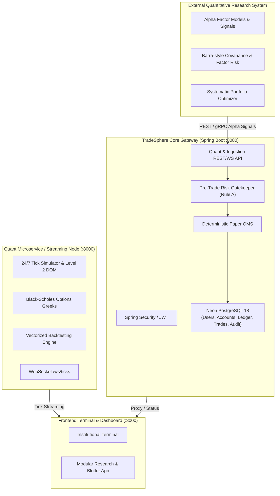
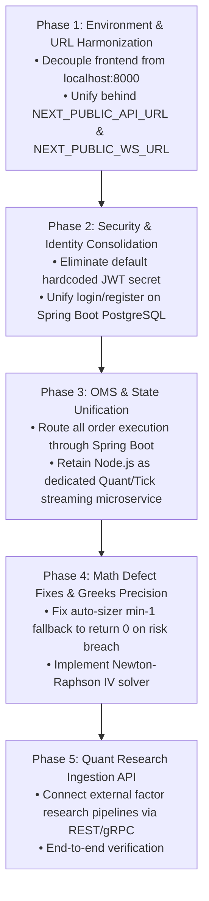

# QUANTITATIVE INVESTMENT RESEARCH INTEGRATION PLAN — APEXTRADEOS / TRADESPHERE AI

**Date:** October 31, 2026  
**Auditor & Architect:** Principal Software Architect (FinTech, Quantitative Systems)  
**Scope:** Architecture roadmap, integration interfaces, mathematical bug fixes, and non-destructive migration sequence for external quantitative research systems.

---

## 1. Executive Vision & Target Architecture

The objective is to integrate TradeSphere AI with an external **Quantitative Investment Research System** (e.g., Python/Rust alpha-research engines, factor modeling pipelines, or systematic portfolio optimizers) without rebuilding existing functional components.

### 1.1 Architectural Evaluation: Consolidated Monolith vs. Microservice Federation



#### Evaluation:
- **Option A (Full Java Port):** Rewrite Black-Scholes Greeks, 20-level DOM generator, and Backtester in Java inside `backend-spring/`.  
  *Pros:* Single runtime, single Docker container.  
  *Cons:* Destructive, eliminates working Node.js tick streaming, slows down quantitative research velocity (quant researchers work in Python/C++/TypeScript).
- **Option B (Federated Microservice with Spring Boot Gateway — RECOMMENDED):**  
  Retain Spring Boot as the **Enterprise Identity, Risk Gatekeeper, and Transactional Ledger Gateway**, while utilizing the high-performance event loop of Node.js (or external Python services) for tick streaming, Level 2 DOM generation, options analytics, and alpha research ingestion.  
  *Pros:* Non-destructive, zero regression of verified features, preserves existing sub-millisecond tick streaming, and provides standardized REST/gRPC interfaces for quant models.

---

## 2. Invariant & Mathematical Defect Resolutions

### 2.1 Resolution of Auto-Position Sizing Bug
- **Affected Files:**
  - [backend/src/oms/risk_engine.js:180-188](file:///c:/Users/hello/Desktop/antigravity%20products/TR%20AI/backend/src/oms/risk_engine.js#L180-L188)
  - [frontend/src/components/app/OrderForm.tsx:72](file:///c:/Users/hello/Desktop/antigravity%20products/TR%20AI/frontend/src/components/app/OrderForm.tsx#L72)

#### Current Flawed Code:
```javascript
const rawQty = maxRiskCapital / riskPerShare;
return Math.max(1, Math.floor(rawQty)); // If rawQty < 1, forces 1 share, breaching risk cap!
```

#### Target Mathematically Exact Specification:
```typescript
/**
 * Strict 1.0% Risk Auto-Sizer.
 * Returns 0 if single-share risk exceeds the max allowed risk capital.
 */
function calculateSafePositionSize(
  netEquity: number,
  entryPrice: number,
  stopLossPrice: number,
  riskPct: number = 1.0
): { quantity: number; riskExceeded: boolean; riskPerShare: number; maxAllowedRisk: number; message?: string } {
  const maxAllowedRisk = netEquity * (riskPct / 100);
  const riskPerShare = Math.abs(entryPrice - stopLossPrice);

  if (riskPerShare <= 0) {
    return { quantity: 0, riskExceeded: false, riskPerShare: 0, maxAllowedRisk, message: 'Invalid Stop-Loss distance.' };
  }

  const rawQty = Math.floor(maxAllowedRisk / riskPerShare);

  if (rawQty < 1) {
    return {
      quantity: 0,
      riskExceeded: true,
      riskPerShare,
      maxAllowedRisk,
      message: `Risk Breach: Minimum 1 share risk (₹${riskPerShare.toFixed(2)}) exceeds your account's ${riskPct.toFixed(1)}% cap (₹${maxAllowedRisk.toFixed(2)}). Select a closer Stop-Loss or a lower-priced instrument.`
    };
  }

  return {
    quantity: rawQty,
    riskExceeded: false,
    riskPerShare,
    maxAllowedRisk
  };
}
```

---

### 2.2 Black-Scholes Greeks & Implied Volatility (IV) Integrity
In [backend/src/quant/options_greeks.js:83-86](file:///c:/Users/hello/Desktop/antigravity%20products/TR%20AI/backend/src/quant/options_greeks.js#L83-L86):
```javascript
const moneyness = Math.log(strike / spotPrice);
const iv = Math.max(0.10, Math.min(0.45, 0.15 + (moneyness * moneyness) * 0.8));
```
- **Finding:** Currently, Implied Volatility is estimated using an ad-hoc quadratic proxy formula, and Open Interest is generated using `Math.random()`.
- **Target Implementation for Quant Integration:**
  1. **Newton-Raphson IV Solver:** Solve for IV numerically from market option prices:
     $$\sigma_{n+1} = \sigma_n - \frac{C_{\text{BS}}(\sigma_n) - C_{\text{market}}}{\nu(\sigma_n)}$$
     where Vega $\nu = S \sqrt{T} \phi(d_1)$ is the analytical derivative.
  2. **External Greeks Ingestion Interface:** Allow the quantitative research system to publish pre-computed Greeks and volatility surfaces directly into the options chain cache.

---

## 3. External Quantitative Research Interface Contracts

To allow external quantitative research systems to submit trade signals, rebalance baskets, and risk metrics, Spring Boot will expose dedicated Quant Ingestion contracts.

### 3.1 Alpha Signal & Basket Ingestion Contract
```json
POST /api/quant/signals
Authorization: Bearer <JWT_SECRET_OR_SERVICE_TOKEN>
Content-Type: application/json

{
  "strategyId": "MOMENTUM_FACTOR_ALPHA_01",
  "modelVersion": "v2.4.1",
  "targetAllocations": [
    {
      "symbol": "RELIANCE",
      "targetWeight": 0.25,
      "recommendedAction": "BUY",
      "entryPriceLimit": 2990.00,
      "stopLoss": 2930.00,
      "takeProfit": 3110.00,
      "alphaScore": 0.87,
      "urgency": "IMMEDIATE"
    },
    {
      "symbol": "TCS",
      "targetWeight": 0.15,
      "recommendedAction": "BUY",
      "entryPriceLimit": 4130.00,
      "stopLoss": 4050.00,
      "takeProfit": 4290.00,
      "alphaScore": 0.72,
      "urgency": "PASSIVE"
    }
  ],
  "rebalanceRiskCap": 1.0,
  "executionMode": "PAPER_SIMULATED"
}
```

### 3.2 Quantitative Risk Ingestion Contract
```json
POST /api/quant/risk-metrics
Authorization: Bearer <SERVICE_TOKEN>
Content-Type: application/json

{
  "timestamp": "2026-10-31T02:00:00Z",
  "portfolioId": 1,
  "var95": 14250.00,
  "expectedShortfall95": 19800.00,
  "factorExposures": {
    "beta": 0.94,
    "size": -0.12,
    "value": 0.35,
    "momentum": 0.68,
    "volatility": -0.22
  },
  "stressTestScenarios": {
    "niftyDrop5Pct": -47200.00,
    "interestRateHike50bps": -8300.00,
    "crudeOilSpike15Pct": -12500.00
  }
}
```

---

## 4. Safe, Non-Destructive Step-by-Step Migration Sequence



### Phase 1: Environment & URL Harmonization
- Replace hardcoded `http://localhost:8000` and `ws://localhost:8000` with configurable environment variables:
  - `NEXT_PUBLIC_API_URL` (defaults to Spring Boot gateway)
  - `NEXT_PUBLIC_WS_URL` (defaults to Node.js / streaming microservice)
- Ensure all Next.js pages (`/terminal`, `/login`, `/register`, `/markets`, `/app/*`) respect these environment variables.

### Phase 2: Security & Identity Consolidation
- Remove the hardcoded JWT secret from `backend-spring/src/main/resources/application.yml:30`.
- Enforce mandatory environment variable `JWT_SECRET` across all profiles.
- Route `/login` and `/register` in frontend directly to Spring Boot's database-backed `AuthController`, ensuring all users receive valid BCrypt and JPA credentials.

### Phase 3: OMS & State Unification
- Update `/terminal`'s `OrderTicket` to submit orders to Spring Boot's authenticated `/api/orders`.
- The single source of truth for balances, positions, orders, and trades becomes PostgreSQL.
- The Node.js service retains its role as a high-speed, stateless **Market Simulator, Level 2 DOM Ladder, and Options Greeks provider**.

### Phase 4: Mathematical Defect Fixes
- Patch `calculatePositionSize` in both `risk_engine.js` and `OrderForm.tsx` to return `0` when `rawQty < 1`.
- Add contextual guidance when risk distance is too wide for user equity.
- Update `options_greeks.js` to replace `Math.random()` open interest with realistic deterministic curves.

### Phase 5: Quant Research System API Ingestion
- Implement `QuantSignalController.java` in Spring Boot to ingest external systematic strategy rebalance signals.
- Validate signals synchronously against `RiskGatekeeper.java` before translating into child paper orders.

---

## 5. Comprehensive Test Plan

| Test Category | Target Subsystem | Test Case Description | Pass Criteria |
| :--- | :--- | :--- | :--- |
| **Pre-Trade Risk** | `RiskGatekeeper.java` | Submit order where `(Entry - SL) * Qty > 1.0% Equity` | HTTP 422 `MAX_LOSS_CAP_EXCEEDED` rejected before execution. |
| **Auto-Sizer Math** | `OrderForm.tsx` & Engine | Equity ₹10,000, TCS Price ₹4,100, SL ₹3,900 (Risk ₹200) | Sizer returns `0 shares` with explicit "Risk Breach" alert. |
| **Circuit Breaker** | `RiskGatekeeper.java` | Simulate cumulative daily loss of 3.1% | Account locked; subsequent order returns `CIRCUIT_BREAKER_ACTIVE`. |
| **Tenant Isolation** | `OrderController.java` | User B queries `/api/orders` while User A has active trades | User B receives empty blotter; zero User A records visible. |
| **Ledger Reconciliation**| `PaperAccountService.java`| Execute 5 Buy orders, 3 Sell orders, 2 Partial exits | Variance between cash ledger and account cash is strictly `0.0000`. |
| **OCO Order Invariant** | `PaperTradingService.java`| Trigger Take-Profit leg on active bracket position | Position closes at TP; Stop-Loss leg immediately transitions to `CANCELLED`. |
| **Never Fill Cancelled**| `PaperTradingService.java`| Cancel open limit order; send price tick crossing limit | Order remains `CANCELLED`; no trade or ledger debit occurs. |
| **Tick Stream Zero Lag**| WebSocket `/ws/ticks` | Stream 120ms ticks to frontend terminal | DOM updates smoothly; terminal chart renders without whole-page re-renders. |
| **JWT Security** | `JwtAuthenticationFilter` | Attempt order placement without Bearer header | HTTP 401 Unauthorized; zero database mutation. |
