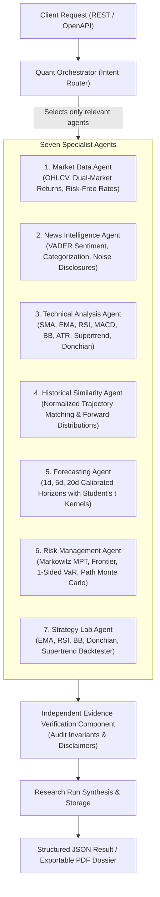

# TradeSphere AI — Quantitative Investment Research Engine (`quant-engine/`)

Institutional, autonomous multi-agent quantitative research and investment analysis microservice. Built independently with Python, FastAPI, Pydantic, NumPy, Pandas, SciPy, and ReportLab.

> **CRITICAL INVARIANT:** Read-only quantitative research and portfolio optimization engine. The Python engine has **zero order execution authority** and **does not write directly into paper-trading accounts**. Persistent user records, authentication, and execution risk gates remain exclusively under Java 21 Spring Boot.

---

## 1. Multi-Agent Architecture

The service coordinates **seven specialist agents** under a selective Orchestrator and an independent **Evidence Verification Component**:



### The Seven Specialist Agents
1. **Market Data Agent:** Historical OHLCV, market benchmarks (NIFTY50, S&P 500, NASDAQ-100), synchronized asset returns with cross-asset correlation matrices, and risk-free benchmarks (RBI 91-day T-Bill ~6.75%, US 3M Treasury ~4.35%).
2. **News Intelligence Agent:** Aggregates verified financial news, computes VADER-baseline compound sentiment scores, classifies headlines into Macro, Earnings, Regulatory, and Technical contexts, and maintains historical sentiment trends. Emphasizes that sentiment is never a guaranteed trading signal.
3. **Technical Analysis Agent:** Zero-drift calculations for moving averages, RSI(14), MACD, Bollinger Bands, ATR(14), Supertrend, and Donchian Channels. Identifies market regimes (`BULLISH_TREND`, `BEARISH_TREND`, `MEAN_REVERSION_RANGE`, `HIGH_VOLATILITY_EXPANSION`).
4. **Historical Similarity / Analogue Agent:** Normalized Euclidean trajectory distance matching against historical regimes; extracts top analogue matches and computes forward return distributions (1d, 5d, 20d). Explicitly disclaims future path repetition.
5. **Forecasting Agent:** Calibrated return distributions for 1-day, 5-day, and 20-day horizons using Student's t kernels to account for fat tails. Provides 80% and 95% confidence intervals and out-of-sample validation metrics (MAE, RMSE, directional accuracy). Never asserts certainty.
6. **Risk Management Agent:** Modern Portfolio Theory (MPT) optimization (Max Sharpe, Min Variance, Efficient Frontier), covariance/correlation matrices, explicit one-sided Value at Risk (Parametric, Historical, Cornish-Fisher), Expected Shortfall (CVaR), and path-based Monte Carlo simulations.
7. **Quantitative Strategy Agent (Strategy Lab):** Vectorized strategy execution across EMA Crossover, RSI Mean Reversion, Bollinger Bands, Donchian Momentum, and Supertrend. Reports Sharpe, Sortino, Calmar, Win Rate, Profit Factor, and running equity curves. Never forces minimum position sizing when risk limits are breached.

---

## 2. Financial Validation & Invariant Enforcements

The engine corrects common defects found in legacy and reference research systems:

| Invariant / Defect Area | Rule Enforced |
| :--- | :--- |
| **Return Assumptions** | Return assumptions are **never silently substituted**. The exact methodology (`Historical Annualized Mean Return`, `CAPM`, or `User-Provided`) is explicitly declared in metadata. |
| **Safe Position Sizing** | If the risk for even a single unit exceeds the account risk cap, position sizing **strictly returns 0 units** (never rounds up to 1 unit). |
| **Prediction Uncertainty** | Predictions are **never called certain**. Output confidence bounds are explicitly accompanied by probabilistic disclaimers. |
| **One-Sided VaR Metric** | VaR is strictly computed as a **one-sided left-tail loss** ($\alpha \in \{0.95, 0.99\}$), never confused with a 2-sided confidence interval. |
| **Path Maximum Drawdown** | In Monte Carlo simulations, maximum drawdown is **evaluated path-by-path** from running equity peaks across all simulated trajectories ($\max_t (Peak_t - W_t)/Peak_t$), never approximated from volatility alone. |
| **Sentiment as Auxiliary** | Sentiment is treated as **noisy auxiliary context** (`signal_guaranteed = False`), accompanied by explicit non-guarantee disclosures. |
| **Reproducibility Metadata** | Every calculation returns inputs, methodology version, data source, data timestamp, limitations, and PRNG seeds for complete auditability. |

---

## 3. Versioned REST API Reference

All endpoints are hosted at `http://localhost:8100`:

### Quantitative Research Endpoints
- `POST /api/v1/quant/research-runs` — Execute selective multi-agent research run based on user query.
- `GET /api/v1/quant/research-runs/{id}` — Retrieve completed research run.
- `POST /api/v1/quant/forecasts` — Generate multi-horizon calibrated return forecast.
- `POST /api/v1/quant/analogues` — Scan and match historical price analogues.
- `POST /api/v1/quant/backtests` — Execute vectorized algorithmic strategy backtest.
- `GET /api/v1/quant/reports/{id}` — Export research report as structured JSON or high-res PDF dossier (`?format=pdf` or `Accept: application/pdf`).

### Wealth Management & Optimization Endpoints
- `POST /api/v1/wealth/optimizations` — Markowitz MPT (Max Sharpe, Min Variance, Efficient Frontier).
- `GET /api/v1/wealth/optimizations/{id}/frontier` — Retrieve cached frontier points.
- `POST /api/v1/wealth/sip-plans` — Regular and step-up SIP projections with annual increment schedules.
- `POST /api/v1/wealth/scenarios` — Goal-based financial scenarios with inflation adjustment and shortfall probabilities.
- `GET /api/v1/wealth/mutual-funds` — Mutual fund performance database with risk/return metrics.
- `POST /api/v1/wealth/monte-carlo` — Path-based stochastic Monte Carlo simulation with true path drawdowns.

### System Endpoints
- `GET /health` and `GET /api/health` — Service liveness and methodology status.
- `GET /docs` — Interactive OpenAPI Swagger UI.

---

## 4. Testing & Verification

Run the comprehensive 34-test suite:
```bash
cd quant-engine
pytest
```
*Result: 34 passed, 0 failed.*

---

## 5. Running the Service

Start the FastAPI microservice:
```bash
cd quant-engine
python main.py
```
Or via Uvicorn:
```bash
uvicorn main:app --host 0.0.0.0 --port 8100 --reload
```
